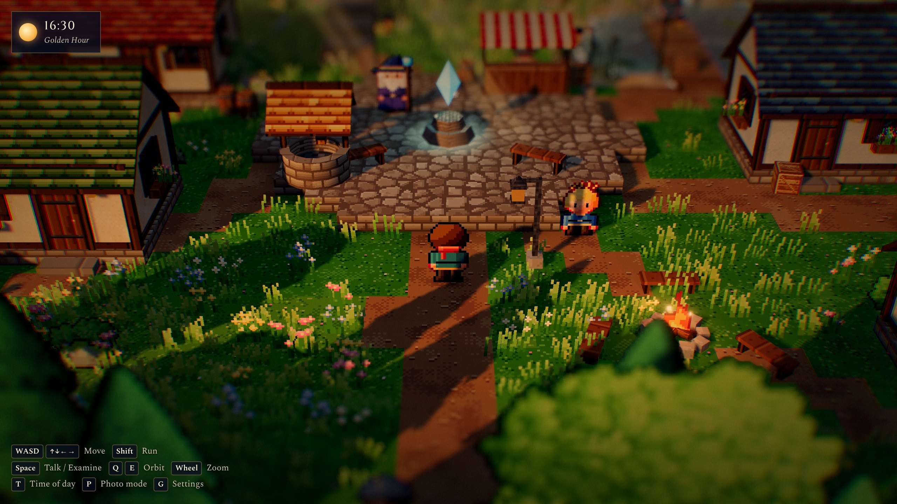
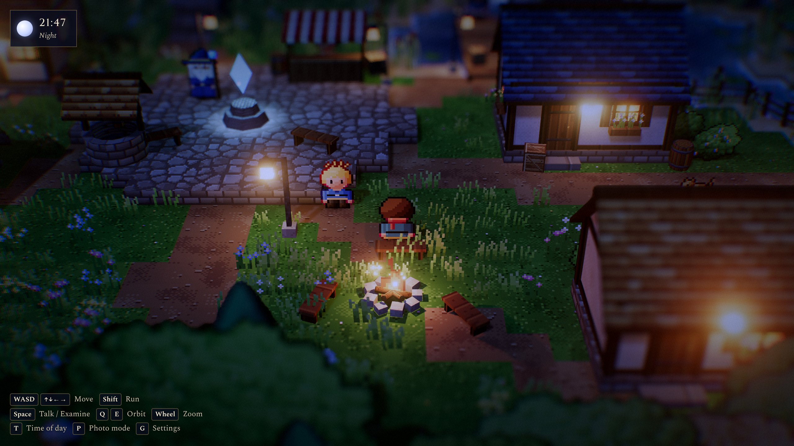
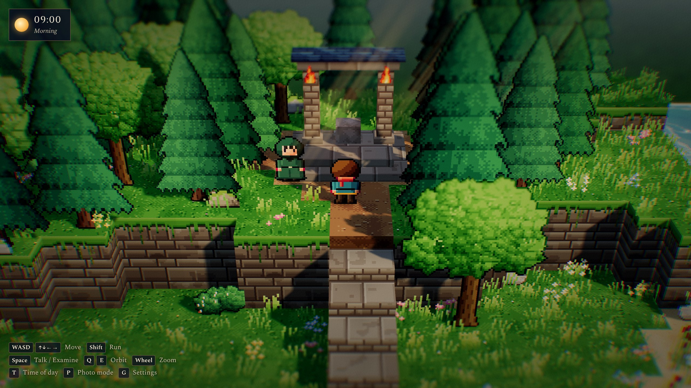
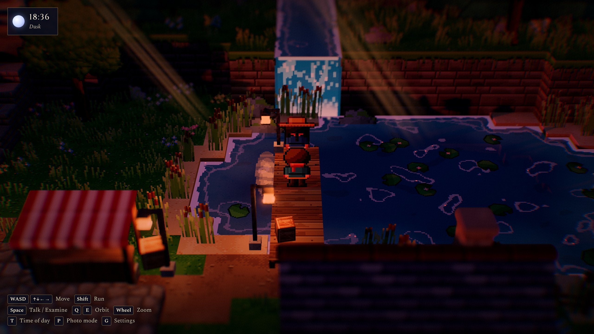

# HD-2D Engine for three.js

A small engine for **HD-2D style games**: crisp pixel-art sprites standing in a lit, stepped 3D diorama, finished with depth of field, tilt-shift, bloom and a filmic colour grade. It comes with **Hollowbrook**, a playable demo village that shows off every feature.



| Night by the campfire | The shrine on the plateau | Dusk on the lake |
| --- | --- | --- |
|  |  |  |

Code paints every texture, sprite and character at startup, so the project ships no image assets and contains no art from existing games.

## Quick start

```bash
npm install
```

```bash
npm run dev
```

Then open the URL Vite prints. Other pages:

- `/` — the Hollowbrook demo
- `/minimal.html` — the smallest useful scene (about 70 lines, see [`examples/minimal.js`](examples/minimal.js))
- `/sprites.html` — a gallery of every procedural sprite, character sheet and tile texture
- `/export.html` — download procedural characters as PNG + Aseprite JSON, and the tileset for Tiled

`npm run build` writes a static site to `dist/`. It uses relative paths, so you can host it anywhere, GitHub Pages included.

## Demo controls

| Input | Action |
| --- | --- |
| `WASD` / arrows | Move (relative to the camera) |
| `Shift` | Run |
| `Space` / `Enter` | Talk, examine, confirm |
| `Q` / `E` / `R` | Orbit the camera / reset |
| Mouse wheel | Zoom |
| `T` | Jump to the next time of day |
| `P` | Photo mode (hide UI) |
| `M` | Mute / unmute |
| `I` | Performance stats overlay |
| `G` | Toggle the settings panel |
| Touch | Drag to move, tap to interact |

Things to try:

- Rest at the campfire to time-lapse the day.
- Touch the crystal in the square.
- Walk behind the cottage to see the occlusion cut-out.
- Take the stone stairs up to the shrine.
- Cross the bridge.
- Talk to everyone, the cat included.

The settings panel (`G`) has live controls for quality presets and the benchmark, audio volumes, time of day, the camera, depth of field, bloom, colour grade, render scale and pixelated upscaling, wind, and shadows.

URL parameters, handy for screenshots and debugging:

| Parameter | Effect |
| --- | --- |
| `notitle` | Skip the title card |
| `nogui` | Start with the settings panel hidden |
| `time=21.5` | Start at a given hour |
| `at=31,16.5` | Spawn the player at tile coordinates `x,z` |
| `yaw=-20` | Start with the camera orbited |
| `dist=30` | Start with a different camera distance |
| `quality=low` | Pin a quality preset (`low`, `medium`, `high`, `ultra`); without it the game starts on `high` in auto mode |
| `stats` | Show the performance overlay |
| `bench` | Run the benchmark right after loading |
| `mute` | Start muted |
| `dpr=2` | Pin the device pixel ratio cap, whatever the preset says |
| `manual` | Don't start the loop; call `hd2d.engine.step(dt)` yourself (for deterministic captures) |

## How the HD-2D look is built

```
scene ─► HDR target (half-float colour + depth, 4× MSAA)
      ─► bokeh depth of field: half-res gather, circle of confusion from depth
         around the player, merged with a screen-space tilt-shift band
      ─► composite sharp / blurred
      ─► bloom (lanterns, fire, water glints, crystal)
      ─► grade: ACES tone map → sRGB → saturation, contrast, tint,
         cool shadow lift, vignette, chromatic fringe, grain, letterbox, fade
```

- **Sprites in 3D.** Billboards turn to face the camera around the vertical axis only, so they stay upright. The rotation happens in the vertex shader, so shadow passes agree with what you see. Sprite normals lean back toward the sky, which lets sun and lamps light the pixel art the way painted HD-2D sprites are lit. Alpha-tested sprites cast real shadows.
- **Stepped diorama terrain.** A tile map with heights in steps of 0.5 becomes merged block geometry with one mesh per texture. Tops use world-space UVs. Side textures are anchored to the top edge, so grassy lips line up on every step. Vertex colours bake voxel ambient occlusion plus per-tile tint variation.
- **Pixel-art shading everywhere.** Painters light shapes with fake normals, quantise them onto hue-shifted ramps (shadows drift blue, highlights warm) with ordered dithering, then add selective outlines. Water and the waterfall snap to the same 16 texels-per-unit grid.
- **Mood through time.** Each day/night keyframe holds sun and moon, bounce light, fog, exposure, grade, god-ray strength and cloud shadows. Lanterns, windows, fireflies and water reflections follow the night level.
- **Volumetric foliage.** Tree, pine and bush sprites are painted with a matching normal map (round canopy clumps, a cylindrical trunk), so the sun lights them from its actual side and the shading moves with the time of day. Their sun shadows are cast as if the card faced the sun (`sunFacingShadow`), so the shadow on the ground stays a full silhouette at any camera angle, and each trunk gets a soft contact shadow at its base. Below the canopy the trunk is a real low-poly 3D mesh with pixel bark and a dark rim (`world/Trunks.js`). It stays round from every camera angle and catches the canopy's shadow. Paint the sprite with `trunk3d: true` and it erases its own lower trunk and reports the size the mesh needs in `pc.trunk`. `?trunks=sprite` brings back the painted trunks for comparison.
- **3D crowns.** Tree crowns can be built from many leaf-cluster billboards placed in 3D around the trunk top (`world/Canopy.js`), so near clusters slide over far ones as the camera turns. Each cluster is painted as a bunch of smaller lobes (`paintLeafCluster`) with its own normal map. Lower and inner clusters sit in the crown's shade, and loose twigs (`paintTwig`) break up the silhouette. Pines stack skirts of needle clumps (`paintNeedleClump`) that narrow to a tip. Every cluster and twig variant of a species is packed into one atlas strip (`packStrip`, and `frames` on `SpriteInstances`), so a whole species costs one draw call plus its shadow passes, the same as a single painted crown. Every style stays in the engine. Each campaign picks its own, as described in [Tree styles per campaign](#tree-styles-per-campaign). The crown layout comes from the tree's position, so it is the same on every load.
- **Soft ground borders.** Where grass meets a path, cobbles, a field or sand at the same height, a strip of grass blades spills over the edge, so ground types don't change in hard tile blocks. The tile type's `fringe` and `priority` control this.
- **Characters that act.** Generated sheets have idle, walk, a separate leaning run, and a talking mouth that moves while the character's line types out. Cutscenes add `hop` reactions and emote balloons.
- **Readable at any angle.** When geometry or foliage sits between the camera and the player, a dithered see-through hole opens in it.

## Engine overview

```
src/engine/
  Engine.js                 renderer, scene, camera, main loop, systems
  render/PostFX.js          DoF + tilt-shift, bloom, tone map and grade
  render/Quality.js         quality presets + auto governor that steps down below ~40 fps
  render/Benchmark.js       times every preset on the same scripted frames
  render/MaterialPatch.js   shader injection: billboarding, wind, cloud shadows,
                            occlusion cut-out, per-instance flip; global uniforms
  render/Materials.js       shared lit world materials
  pixel/PixelCanvas.js      tiny RGBA canvas for authoring pixel art in code
  pixel/Palette.js          hue-shifted colour ramps
  pixel/TextureFactory.js   tileable ground, cliff, brick, roof, wood, window... textures
  pixel/SpriteFactory.js    trees, pines, bushes, grass, flowers, reeds, rocks, fire, lily pads
  pixel/CharacterFactory.js paper-doll 4-direction character sheets (+ a cat)
  sprites/Billboard.js      animated camera-facing sprites + SpriteAnimator
  sprites/SpriteInstances.js thousands of static sprites in one draw call
  world/TileMap.js          heights, tile types, solids, bridge decks
  world/TerrainBuilder.js   tile map → merged block meshes with baked AO
  world/World.js            ground queries, step-limited walkability, colliders, zones, triggers
  world/NavGrid.js          A* path finding with string pulling
  world/TileTypes.js        built-in tile types (outdoor and interior)
  game/GameMap.js           a loaded level: scene, world, NPCs, lights, effects, spawns, scripts
  game/MapData.js           native map format + Tiled (.tmj) importer
  game/MapBuilder.js        map data → GameMap (terrain + prefabs)
  game/Prefabs.js           object types: npc, spawn, warp, trigger, inspect, light, fire,
                            furniture, particles, light shafts, sprites…
  game/Events.js            JSON event scripts for dialogue and cutscenes
  game/SaveSystem.js        save games and settings in localStorage
  sprites/SpriteSheet.js    load sprite sheets from PNG grids or Aseprite JSON
  sprites/Emote.js          "!" "?" "♪" balloons over heads
  world/Water.js            pixel water (shore foam, glints, lamp reflections) and waterfall
  world/Props.js            houses with gable roofs, fences, lamps, well, decks, stall...
  world/StaticBatch.js      merges static props per material
  lighting/DayNightCycle.js keyframed time of day + stable shadow frustum
  lighting/FlickerLight.js  lamps and fires that switch on at night (light *sources*)
  lighting/LightPool.js     a few real PointLights handed to the sources that matter most
  lighting/LightShaft.js    additive god rays that lean with the sun
  fx/Particles.js           embers, smoke, fireflies, dust, mist, leaves, petals, sparkles
  audio/AudioEngine.js      buses, reverb, limiter, noise, 2D spatialisation, unlock on gesture
  audio/Synth.js            pluck, pad, bass, bell, noise-hit, blip and chirp voices
  audio/Music.js            generative 3/4 music with day and night moods
  audio/Ambience.js         wind, positional water and fire, birds, crickets
  audio/Sfx.js              footsteps per surface, dialogue voices, UI, chimes
  camera/CameraRig.js       long-lens follow camera, orbit, zoom, intro fly-in
  entities/Character.js     walking sprite with collision, steps and facing
  entities/Behaviours.js    Wander and Patrol AI (path-finding aware)
  input/Input.js            keyboard, wheel, touch stick
  ui/UI.js, ui/ui.css       dialogue with choices, banners, prompts, HUD, title card
src/demo/Game.js            Hollowbrook game shell: maps, saves, events, audio, UI
src/demo/maps/village.js    the village, built in code
public/maps/inn.tmj         the inn interior, a Tiled map
public/sprites/             the innkeeper's sheet as PNG + Aseprite JSON
examples/minimal.js         a minimal scene using the public API
```

Everything is exported from `src/engine/index.js`. A minimal scene looks like this:

```js
import * as THREE from 'three';
import { Engine, TileMap, buildTerrain, World, Character, makeCharacterSheet,
         DayNightCycle, CameraRig, Input } from './src/engine/index.js';

const engine = new Engine({ container: document.body });
const map = new TileMap(24, 24, [{ name: 'grass', top: 'grass', side: 'earthSide' }]);
map.fillRect(0, 0, 23, 23, 0, 'grass');
engine.scene.add(buildTerrain(map));

const world = new World(map);
const hero = new Character(world, makeCharacterSheet({ tunic: '#a8423a' }), { x: 12, z: 16 });
engine.scene.add(hero.root);

const sun = new THREE.DirectionalLight(); sun.castShadow = true;
const hemi = new THREE.HemisphereLight();
engine.scene.add(sun, sun.target, hemi);
const cycle = new DayNightCycle({ scene: engine.scene, sun, hemi, post: engine.post, time: 16.5 });

const rig = new CameraRig(engine.camera); rig.follow = hero; rig.snap();
const input = new Input(engine.renderer.domElement);
engine.addSystem((dt) => {
  const a = input.axis();
  hero.intent.set(a.x, -a.y);          // camera yaw 0: screen up = -z
  hero.update(dt, rig.yaw);
  rig.update(dt);
  cycle.focus.copy(hero.position);
  cycle.update(dt);
  input.endFrame();
});
engine.start();
```

## Maps, sprites, events and saves

The game holds what survives a map change (player, camera, audio, UI, story flags, saves) and loads maps on demand. A map can be built in code like the village, or loaded from data like the inn. Both become the same `GameMap`. Maps you leave stay in memory, so NPCs and effects are where you left them when you come back.

### Maps from Tiled

Open `public/maps/inn.tmj` in [Tiled](https://www.mapeditor.org) to see the conventions:

- **`ground` tile layer:** paint with the tiles of `tilesets/hd2d-tiles.tsj`. Each tile's `type` property names a tile type (grass, path, cobble, floor, wall, hearth…; see `TileTypes.js`).
- **`height` tile layer** (optional): tiles carry a `height` property in world units (steps of 0.5).
- **Object layers:** an object's class (type) picks a prefab and its custom properties configure it. Rectangles give size; points give position.
  - `npc`: `sheet` (`cast:<key>` or a file path), `dialogue` (lines separated by `|`) or `script`, `behaviour` (`wander`), `facing`, `voice`
  - `spawn` (`facing`), `warp` (`map`, `spawn`), `trigger` (`script`, `once`), `inspect` (`label`, `text` or `script`), `zone` (`title`, `subtitle`)
  - `light`, `fire`, `particles` (`preset`), `shaft`, `sprite` (`sprite`: tree, bush, rock…)
  - furniture: `table`, `stool`, `counter`, `shelf`, `bed`, `fireplace`, `window`, `rug`, `barrel`, `crate`, `bench`, `lamppost`
- **Map properties:** `title`, `subtitle`, `indoor`, `cameraDistance`, `cameraPitch`, `cameraBounds` (`minX,minZ,maxX,maxZ`), `edgeDepth`, `scripts` (JSON of named event scripts).

Save tile layers as CSV, and keep tilesets as JSON (`.tsj`) or embedded. Add your own object types with `prefabs.register('type', (obj, ctx) => …)`. There is also a compact native format (`toNative()` / `parseMapData()`).

### Sprites from files

`loadSpriteSheet(url)` accepts an Aseprite JSON export or a PNG in the engine's character grid. Name Aseprite tags `<animation>_<direction>`, for example `idle_down`, `walk_left`, `run_up` or `talk_down`. `talk` plays while that character's line is typing out. Frame durations set the speed, and forward, reverse and pingpong tags all work. Use `/export.html` to get any procedural character as a starting point you can repaint. The innkeeper in the inn is loaded this way.

### Events and cutscenes

Dialogue and cutscenes are JSON command lists (`say`, `choose`, `walk`, `face`, `emote`, `hop`, `camera`, `fade`, `time`, `flag`, `if`, `warp`, `sound`, `banner`, `save`, `run`). `walk` uses the path finder, so actors go around furniture and up stairs. The full list is documented at the top of `src/engine/game/Events.js`. The village's opening scene and the inn's welcome are both written this way.

### Tree styles per campaign

Tree style is an art-direction choice, so the engine keeps every option and the campaign picks one (`engine/world/Trees.js`):

| key | options | look |
| --- | --- | --- |
| `broadleaf` | `sprite`, `clusters`, `twigs` | one painted crown; leaf clusters in 3D; clusters plus loose twigs |
| `conifer` | `sprite`, `layers` | one painted pine; stacked skirts of needle clumps |
| `trunks` | `3d`, `sprite` | round 3D trunk or painted trunk under sprite crowns (cluster crowns always use 3D) |

The demo campaign sets its style in `src/demo/campaign.js`:

```js
foliage: { broadleaf: 'twigs', conifer: 'sprite', trunks: '3d' },
```

Settings are applied in layers, and each layer overrides the one before: the engine default (`DEFAULT_FOLIAGE`), then the campaign, then the map, then debug URL parameters. A Tiled map sets its own with a `foliage` string property such as `{"conifer":"layers"}`. A code map passes an object to `game.foliageFor({...})`. While testing, you can override the style from the address bar with `?canopy=`, `?pines=` and `?trunks=`. Unknown keys or values are reported in the console and ignored.

In code, `new TreeSpecies({ kind: 'broadleaf' | 'conifer', style, seed, leaf, bark, fruit, tiers, capacity })` builds one species in the chosen style. Call `add(x, y, z, { scale, flip, tint })` to plant a tree, then `finalize()`, then add `meshes` to the scene. In Tiled maps, a `tree` object (props `kind`, `seed`, `leaf`, `bark`, `fruit`, `scale`, `tint`) or a `sprite` object with `sprite` set to `tree` or `pine` follows the map's style. Trees that look the same share their meshes.

### Saving

Touching the crystal saves, and so does every map change. The title screen then offers **Continue**. Saves keep the map, position, facing, time of day and story flags. Settings (quality, volumes, mute) are stored separately. If browser storage is unavailable, the game runs without saving. `?nosave` ignores saves for testing, `?map=inn&at=7,6` starts anywhere, and the settings panel has **World → go to map / save now / delete save**.

## Performance and quality

Four presets cover everything that costs GPU time:

| Preset | Pixel ratio cap | Render scale | MSAA | DoF samples | Sun shadow map | Point lights | Point shadows | Ground cover | Particles |
| --- | --- | --- | --- | --- | --- | --- | --- | --- | --- |
| low | 1 | 0.75 | off | 16 | 1024 | 4 | off | 45% | 50% |
| medium | 1.25 | 1 | 2× | 24 | 2048 | 6 | off | 75% | 75% |
| high | 1.5 | 1 | 4× | 40 | 2048 | 8 + 1 | on (every 2nd frame) | 100% | 100% |
| ultra | 2 | 1 | 4× | 56 | 4096 | 10 + 1 | on | 100% | 100% |

- **Auto mode** (the default) starts on `high` and steps down one preset whenever the game averages under ~40 fps over a few seconds. It never steps back up on its own, so it can't oscillate. Pick a fixed preset in **Performance → quality** or with `?quality=`.
- **Light pool.** The village has 13 light sources (street lamps, door lanterns, the campfire, the crystal and the shrine), but shaders only ever evaluate the preset's few real point lights. Each frame the pool hands them to the sources closest to the player and fades lights in and out as they swap. The campfire's point shadows use a dedicated light that stops rendering its shadow map when it's out of range.
- **Stats overlay** (`I`): fps and frame time, CPU time, draw calls and triangles, active point lights, internal resolution and preset.
- **Benchmark** (**Performance → run benchmark**, or `?bench`): it flies the same route at dusk (lamps and god rays on) for 5 seconds per preset. It then shows average fps, the slowest 1% of frames, frame and CPU time, and draw calls. Run it on the machines you care about, because numbers from one GPU say little about another.
- Foliage is instanced, and static props are merged per material.

## Audio

All sound is synthesised at runtime with the Web Audio API, so there are no audio files. Browsers only allow sound after a click, key press or tap, so it starts with the first input (or when you dismiss the title card).

- **Music:** a generative pastoral piece in 3/4 (harp arpeggio, pad, bass and melodies composed per phrase in an A-A-B-A form). It switches to a slower, sparser, bell-led night mood after dusk. The switch waits for the next phrase, and the music ducks under dialogue and while resting.
- **Ambience:** drifting wind (stronger on the plateau), a waterfall and river that fade and pan with your position, a crackling campfire, birdsong by day, crickets at night.
- **Effects:** footsteps that change with the ground (grass, dirt, sand, stone, wooden decks), a per-character dialogue "voice", UI ticks, the crystal's bell arpeggio, a lullaby when resting, a chime for location banners.

## Tests

```bash
npm test
```

Unit tests run in plain Node (`node --test`), finish in under a second and cover:

- path finding, step limits and colliders
- the Tiled importer (against the real `inn.tmj`) and the native format round-trip
- event scripts
- the music generator's harmony
- saving, including blocked storage
- the shader injections. If a three.js upgrade renames a shader chunk the engine hooks into, this test fails instead of an effect silently disappearing. At runtime the engine also warns once in the console: `[hd2d] shader injection point missing`.

```bash
npm run test:e2e
```

Browser tests start their own Vite server and drive headless Chromium through [Playwright](https://playwright.dev). The game runs in deterministic `?manual` mode, stepped frame by frame. They check that:

- the village and inn boot without console errors and render a lit, non-blank frame
- every quality preset applies
- the tool pages load
- the whole player loop works: opening cutscene, entering the inn, the innkeeper's path-found welcome, renting a room, leaving, and **Continue** after a reload

They use software WebGL, so they need no GPU. Expect a few minutes on CI. On a new machine, install the browser once with `npx playwright install chromium`.

## Battles

The engine ships no battle system on purpose. [`docs/batalhas/contrato.md`](docs/batalhas/contrato.md) (in Portuguese) is the contract campaigns implement their own rules against. It covers responsibilities, life cycle, interfaces, the effect pipeline, data formats, guarantees and contract tests. Status: draft, not implemented yet.

## Credits

- Built on [three.js](https://threejs.org) (`0.186.1`) and [lil-gui](https://lil-gui.georgealways.com), with [Vite](https://vite.dev) for development.
- UI fonts are Cinzel and Spectral, loaded from Google Fonts. If they can't load, the UI falls back to system serif fonts.
- The visual style takes its cue from the "HD-2D" look in general. The village, characters and all artwork are original and generated procedurally.
